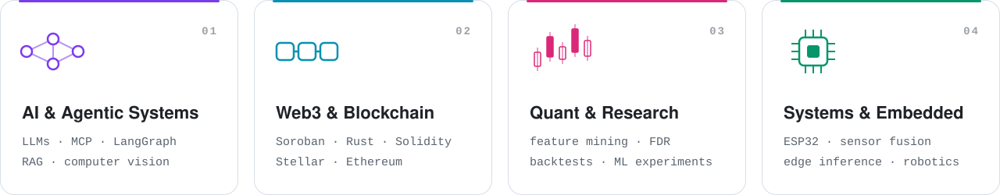

<picture>
  <source media="(prefers-color-scheme: dark)" srcset="assets/header-dark.svg">
  
</picture>

 

 

I'm a second-year **Data Science & AI** undergrad at **IIT Mandi** who builds where AI meets real systems: LLM agents that use tools safely, smart contracts on Stellar, research pipelines that survive statistical scrutiny, and sensor nodes that run ML at the edge.

> I like taking ideas from **paper → model → system → something that actually runs.**

<picture>
  <source media="(prefers-color-scheme: dark)" srcset="assets/tracks-dark.svg">
  
</picture>

## 🏆 Wins

| | Competition | Project |
|:-:|---|---|
| 🥇 | **1st Prize** · Aya Community Build & Learn Week | [Governance Budget Allocator](https://github.com/arywk40-hue/WEB3): role-based shared budgets in Rust on Soroban |
| 🥈 | **2nd Prize** · HackBio | |
| 🥉 | **2nd Runner-Up** · Weilliptic, Xpecto '26 (IIT Mandi) | [LexAudit](https://github.com/arywk40-hue/welliptic): AI contract review with an on-chain audit trail |
| 🥉 | **3rd Prize** · Space Code, STAC Club | |
| 🏅 | **5th Prize** · Simplify AI Hackathon 2025 | [FeelEase](https://github.com/arywk40-hue/FEEL-EASE-CHAT-BOT): multilingual mental-health chatbot |

**Leaderboards** · AIHack India (IIT Mandi SoM): **rank 16**, public score 0.768 on unsecured-loan default prediction · KRACKHACK: DINOv2 off-road segmentation, **40.5% mIoU** (6 classes) / 24.3% (10 classes)

<picture>
  <source media="(prefers-color-scheme: dark)" srcset="assets/divider-dark.svg">
  
</picture>

## ⚡ Featured work

<table>
<tr>
<td width="50%" valign="top">

### 🌦️ [INDRA](https://github.com/arywk40-hue/DP-IC-202-)
**Edge weather & hazard intelligence for India**

BME280 and PMS7003 sensor nodes run C++ models on ESP32-S3 for cloudburst and snowstorm risk. They are backed by a forecasting ensemble covering **587 stations across 6 agro-climatic zones**, with a +6 h validation MAE of **1.14 °C**. **402 tests** pass.

`C++17` `ESP32-S3` `XGBoost` `Python` · mentored by Dr. Kaushik Halder

</td>
<td width="50%" valign="top">

### 🛡️ [VegaGuard](https://github.com/arywk40-hue/alpaca)
**Paper-only options agent for the Alpaca AI Trading Agents Hackathon**

Scans liquid ETFs, builds defined-risk debit spreads and passes every trade through a risk critic. *The model can explain a trade, but it can't authorize one.* Ships dry-run by default with **186 tests passing**.

`Python` `MCP` `Alpaca API` `Agents`

</td>
</tr>
<tr>
<td width="50%" valign="top">

### ⚖️ [LexAudit](https://github.com/arywk40-hue/welliptic)
**AI legal contract review with an on-chain audit trail**

Extracts clauses, scores risk and enforces a human-in-the-loop gate. Every step is logged immutably through Weilliptic MCP applets.

`LangChain` `LangGraph` `MCP` `Weilchain` · 🥉 Xpecto '26

</td>
<td width="50%" valign="top">

### 🤝 [ServiceSetu](https://github.com/arywk40-hue/ServiceSetu)
**Agentic local-service booking on Fetch.ai**

Book a trusted provider, approve the exact price and recover automatically when they cancel, all in one ASI:One conversation. Payments run in test mode. **346 tests passing**.

`Python` `Fetch.ai uAgents` `ASI:One` `Razorpay / Stripe test mode`

</td>
</tr>
<tr>
<td width="50%" valign="top">

### 📚 [Study Companion](https://github.com/arywk40-hue/Multimodal-2026)
**A tutor grounded in your own PDFs, slides and lectures**

A second model from a different family checks every claim against the passage it cites. Each citation opens the exact page region, slide or video second. Also includes lessons, flashcards and voice input.

`Python` `FastAPI` `RAG` `Multimodal` `React`

</td>
<td width="50%" valign="top">

### ⛓️ [GeoLedger](https://github.com/arywk40-hue/Stellar)
**Transparent donations on Stellar**

Donations carry geolocation metadata and NGOs submit impact evidence, all backed by Soroban contracts for escrow, verification and NFTs.

`Rust` `Soroban` `Next.js`

</td>
</tr>
</table>

### 🚧 Building now

| Project | Done so far | Next |
|---|---|---|
| 📈 [HFT Quant Research](https://github.com/arywk40-hue/hft) | Development study on 70 trading days: 691 masked features × 5 horizons, **543 survive Benjamini–Hochberg FDR**; Ridge / Elastic Net / LightGBM compared | Holdout validation (days 86–108), cluster extension |
| 🗣️ [Rajasthani LLM](https://github.com/arywk40-hue/Rajasthani-llm) | ASR / MT / TTS pipeline, real IndicTrans2 & Whisper inference wrappers, verified WER / chrF++ metrics | Dialect speech & text collection, then fine-tuning for Marwari, Mewari, Dhundhari, Hadoti, Mewati, Bagri |
| 👵 [ElderCare Guardian](https://github.com/arywk40-hue/Three-Musketeers) | Wearable for vitals, fall detection, SOS & caregiver alerts (team, v1.0.0-beta) | Pre-pilot field trial |
| 🌳 [Outside Case](https://github.com/arywk40-hue/pocket-quest) | Detective walk game with local Gemma photo review, Hacktoberfest 2026 | Real-photo evaluation & outdoor trial |

<b>🧪 More builds</b> (click to expand)

 

| Area | Project | What it is |
|---|---|---|
| AI / ML | [CiteTutor](https://github.com/arywk40-hue/hacktober) | Local study helper: Gemma drafts, Qwen verifies, all grounded in your PDFs |
| AI / ML | [Mess Queue Management](https://github.com/arywk40-hue/MQM) | Computer-vision congestion monitor for the IIT Mandi mess (Robotronics Club) |
| AI / ML | [Bone Fracture Classification](https://github.com/arywk40-hue/kbg) | 12-class X-ray classifier, Kamand Bioengineering Group Hackathon 2025 |
| AI / ML | [Bias Mirror](https://github.com/arywk40-hue/bias-mirror) | Meeting-equity auditor using speaker diarization |
| AI / ML | [FeelEase](https://github.com/arywk40-hue/FEEL-EASE-CHAT-BOT) | Streamlit + Gemini support chatbot in English, Hindi & Bengali with TTS (🏅 Simplify AI) |
| AI / ML | [PlantWhisperer Pro](https://github.com/arywk40-hue/plant-wishperer) | Crop-health monitoring dashboard prototype |
| AI / ML | [Meta-X](https://github.com/arywk40-hue/META-X) | OpenEnv RL environment for tabular data cleaning, Meta hackathon |
| Agents | [VentureSwarm](https://github.com/arywk40-hue/zynd) | Multi-agent startup-intelligence swarm on the ZyndAI Agent SDK |
| Web3 | [Governance Budget Allocator](https://github.com/arywk40-hue/WEB3) | Role-based shared budgets on Soroban (🥇 Aya Build & Learn Week) |
| Web3 | [AuraVerse](https://github.com/arywk40-hue/AYA) | NFT marketplace with auctions & royalties (Solidity, Hardhat, React) |
| Hackathons | [Marswalk Navigator](https://github.com/arywk40-hue/marswalk-navigator) | EVA route & hazard planner for Mars, NASA Space Apps 2026 |
| Hackathons | [RekhaMap](https://github.com/arywk40-hue/RekhaMap) | Urban parcel-mapping frontend prototype, SIH 2026 |
| Hackathons | [CampusFlow](https://github.com/arywk40-hue/samrt--campus) | Conflict-free campus resource allocation |
| Hackathons | [Suraksha Yatra](https://github.com/arywk40-hue/Suraksha-) | Tourist-safety control room with risk scoring & emergency workflows |
| Hardware | [PID Line Follower](https://github.com/arywk40-hue/F-D-P) | 5-sensor ESP32 robot with calibration & Kalman filtering |
| Hardware | [Robotronics](https://github.com/arywk40-hue/Robotronics) | Dijkstra, A*, flood fill & DFS for robot pathfinding |
| Hardware | ESP32 RC Car · RC Plane | Wi-Fi vehicle control and flight electronics |
| Misc | Campus Navigator · NASA NEO Hazard · Cricket Analytics · Deepfake-proof eKYC · Supply Chain Platform | Pathfinding, gradient boosting, IPL analytics, identity verification, distributed backend |

<picture>
  <source media="(prefers-color-scheme: dark)" srcset="assets/divider-dark.svg">
  
</picture>

## 🧰 Toolbox

**Work in daily**

**Build with**

**Exploring:** Solana · IPFS · zero-knowledge proofs · MCP tool design · LangGraph multi-agent flows

## 🌱 Open source & community

**[PyBaMM](https://github.com/pybamm-team/PyBaMM)**: NumFOCUS-sponsored, physics-based battery simulation in Python

- Pull request: [Evaluate processed variables at custom-named spatial coordinates](https://github.com/pybamm-team/PyBaMM/pull/6053) (fixes [#3441](https://github.com/pybamm-team/PyBaMM/issues/3441))
- Issues with reproductions: [#6051](https://github.com/pybamm-team/PyBaMM/issues/6051) (NaN parameter reported as "not found") · [#6052](https://github.com/pybamm-team/PyBaMM/issues/6052) (invalid mesh inputs raise raw errors)
- Code reviews: [#6044](https://github.com/pybamm-team/PyBaMM/pull/6044) · [#6020](https://github.com/pybamm-team/PyBaMM/pull/6020) · [#5979](https://github.com/pybamm-team/PyBaMM/pull/5979) · [#5981](https://github.com/pybamm-team/PyBaMM/pull/5981)

**Community**

- **Google Developer Groups, IIT Mandi** · Blockchain core member, running Web3 sessions and campus developer events
- **MLH Hacktoberfest 2026** · Co-ran the campus session, handed out swag and helped first-time contributors
- **PRAYAS 4.0** · Class Coordinator under CCE & B-States, IIT Mandi
- **GirlScript Summer of Code** · Open-source contributor
- **Linux Foundation LFC102** · Inclusive Open Source Community Orientation ([verify](https://openprofile.dev/?lfajs_aid=29774113-4b53ca54-8e7d-4d8a-818a-3e2d9c6895d3))
- Stellar & Ethereum bootcamps

## 📡 Activity

<picture>
  <source media="(prefers-color-scheme: dark)" srcset="https://streak-stats.demolab.com?user=arywk40-hue&theme=transparent&hide_border=true&ring=A78BFA&fire=22D3EE&currStreakLabel=A78BFA&sideLabels=8B949E&dates=8B949E&currStreakNum=E6EDF3&sideNums=E6EDF3&stroke=1F2A3C">
  
</picture>

  

<picture>
  <source media="(prefers-color-scheme: dark)" srcset="https://raw.githubusercontent.com/arywk40-hue/ARYWK40-HUE/output/snake-dark.svg">
  
</picture>

 

<picture>
  <source media="(prefers-color-scheme: dark)" srcset="assets/footer-dark.svg">
  
</picture>
