<picture>
  <source media="(prefers-color-scheme: dark)" srcset="assets/header-dark.svg">
  
</picture>

 

 

I'm a second-year **Data Science & AI** undergrad at **IIT Mandi** who builds where AI meets real systems: LLM agents that use tools safely, smart contracts on Stellar, research pipelines that survive statistical scrutiny, and sensor nodes that run ML at the edge.

> I like taking ideas from **paper → model → system → something that actually runs.**

<picture>
  <source media="(prefers-color-scheme: dark)" srcset="assets/tracks-dark.svg">
  
</picture>

## Wins

| | Competition | Project |
|:-:|---|---|
| 🥇 | **1st Prize** · Aya Community Build & Learn Week | [Governance Budget Allocator](https://github.com/arywk40-hue/WEB3): role-based shared budgets in Rust on Soroban |
| 🥈 | **2nd Prize** · HackBio | |
| 🥉 | **2nd Runner-Up** · Weilliptic, Xpecto '26 (IIT Mandi) | [LexAudit](https://github.com/arywk40-hue/welliptic): AI contract review with an on-chain audit trail |
| 🥉 | **3rd Prize** · Space Code, STAC Club | |
| 🏅 | **5th Prize** · Simplify AI Hackathon 2025 | [FeelEase](https://github.com/arywk40-hue/FEEL-EASE-CHAT-BOT): multilingual mental-health chatbot |

**Leaderboards** · AIHack India (IIT Mandi SoM): **rank 16**, public score 0.768 on unsecured-loan default prediction · KRACKHACK: DINOv2 off-road segmentation, **40.5% mIoU** (6 classes) / 24.3% (10 classes)

<picture>
  <source media="(prefers-color-scheme: dark)" srcset="assets/divider-dark.svg">
  
</picture>

## Featured projects

<a href="https://github.com/arywk40-hue/indra">
<picture>
  <source media="(prefers-color-scheme: dark)" srcset="assets/card-indra-dark.svg">
  
</picture>
</a>

**[INDRA](https://github.com/arywk40-hue/indra)** · C++17, ESP32-S3, XGBoost, FastAPI, React · team of six, mentored by Dr. Kaushik Halder 
Validated offline on 35,520 observations across 587 stations. A three-node field pilot around Mandi is next.

 

<a href="https://github.com/arywk40-hue/vegaguard">
<picture>
  <source media="(prefers-color-scheme: dark)" srcset="assets/card-vegaguard-dark.svg">
  
</picture>
</a>

**[VegaGuard](https://github.com/arywk40-hue/vegaguard)** · Python, Alpaca API and MCP, FastAPI, SQLite · Alpaca AI Trading Agents Hackathon 
One full paper-trade lifecycle completed so far. A multi-week paper run and a selected-versus-rejected comparison are next.

 

<a href="https://github.com/arywk40-hue/Multimodal-2026">
<picture>
  <source media="(prefers-color-scheme: dark)" srcset="assets/card-study-dark.svg">
  
</picture>
</a>

**[Study Companion](https://github.com/arywk40-hue/Multimodal-2026)** · Python, FastAPI, React, Qwen, Gemma, BGE-M3 · team of four 
Metrics come from a 22-question human-reviewed pilot. The 100-question benchmark with an independent judge is next.

<picture>
  <source media="(prefers-color-scheme: dark)" srcset="assets/divider-dark.svg">
  
</picture>

## More projects

| Project | What it is |
|---|---|
| [LexAudit](https://github.com/arywk40-hue/welliptic) | AI contract review with a human-in-the-loop gate and an on-chain audit trail (LangGraph, MCP) |
| [ServiceSetu](https://github.com/arywk40-hue/ServiceSetu) | Approval-gated local-service booking with Fetch.ai agents and test-mode payments; 346 tests |
| [GeoLedger](https://github.com/arywk40-hue/Stellar) | Donations with geolocation and NGO impact evidence, backed by Soroban contracts |
| [Marswalk Navigator](https://github.com/arywk40-hue/marswalk-navigator) | EVA route and hazard planner for Mars, NASA Space Apps 2026 |
| [Meta-X](https://github.com/arywk40-hue/META-X) | OpenEnv RL environment for tabular data cleaning, Meta hackathon |

<b>All other builds</b>

 

| Area | Project | What it is |
|---|---|---|
| AI / ML | [CiteTutor](https://github.com/arywk40-hue/hacktober) | Local study helper: Gemma drafts, Qwen verifies, grounded in your PDFs |
| AI / ML | [Mess Queue Management](https://github.com/arywk40-hue/MQM) | Computer-vision congestion monitor for the IIT Mandi mess (Robotronics Club) |
| AI / ML | [Bone Fracture Classification](https://github.com/arywk40-hue/kbg) | 12-class X-ray classifier, Kamand Bioengineering Group Hackathon 2025 |
| AI / ML | [Bias Mirror](https://github.com/arywk40-hue/bias-mirror) | Meeting-equity auditor using speaker diarization |
| AI / ML | [FeelEase](https://github.com/arywk40-hue/FEEL-EASE-CHAT-BOT) | Streamlit + Gemini support chatbot in English, Hindi and Bengali with TTS |
| AI / ML | [PlantWhisperer Pro](https://github.com/arywk40-hue/plantwhisperer) | Crop-health monitoring dashboard prototype |
| AI / ML | [Outside Case](https://github.com/arywk40-hue/pocket-quest) | Detective walk game with local Gemma photo review, Hacktoberfest 2026 |
| Agents | [VentureSwarm](https://github.com/arywk40-hue/zynd) | Multi-agent startup-intelligence swarm on the ZyndAI Agent SDK |
| Web3 | [Governance Budget Allocator](https://github.com/arywk40-hue/WEB3) | Role-based shared budgets on Soroban, 1st at Aya Build & Learn Week |
| Web3 | [AuraVerse](https://github.com/arywk40-hue/AYA) | NFT marketplace with auctions and royalties (Solidity, Hardhat, React) |
| Hackathons | [RekhaMap](https://github.com/arywk40-hue/RekhaMap) | Urban parcel-mapping frontend prototype, SIH 2026 |
| Hackathons | [CampusFlow](https://github.com/arywk40-hue/campusflow) | Conflict-free campus resource allocation |
| Hackathons | [Suraksha Yatra](https://github.com/arywk40-hue/suraksha-yatra) | Tourist-safety control room with risk scoring and emergency workflows |
| Hardware | [ElderCare Guardian](https://github.com/arywk40-hue/Three-Musketeers) | Wearable for vitals, fall detection and SOS alerts (team, v1.0.0-beta) |
| Hardware | [PID Line Follower](https://github.com/arywk40-hue/F-D-P) | 5-sensor ESP32 robot with calibration and Kalman filtering |
| Hardware | [Robotronics](https://github.com/arywk40-hue/Robotronics) | Dijkstra, A*, flood fill and DFS for robot pathfinding |

### Building now

| Project | Done so far | Next |
|---|---|---|
| [HFT Quant Research](https://github.com/arywk40-hue/hft) | Development study on 70 trading days: 691 masked features × 5 horizons, **543 survive Benjamini–Hochberg FDR**; Ridge, Elastic Net and LightGBM compared | Holdout validation (days 86–108) |
| [Rajasthani LLM](https://github.com/arywk40-hue/Rajasthani-llm) | ASR / MT / TTS pipeline, IndicTrans2 and Whisper inference wrappers, verified WER and chrF++ metrics | Dialect data collection, then fine-tuning |

## Toolbox

**Daily:** Python · C++ · PyTorch · scikit-learn · pandas · NumPy · LangChain · Streamlit · Git · Linux 
**Build with:** Rust · Solidity · Stellar / Soroban · Ethereum · TensorFlow · TypeScript · FastAPI · Ollama · ESP32 · Arduino 
**Exploring:** Solana · IPFS · zero-knowledge proofs · MCP tool design · LangGraph multi-agent flows

## Open source & community

**[PyBaMM](https://github.com/pybamm-team/PyBaMM)**: NumFOCUS-sponsored, physics-based battery simulation in Python

- Pull request: [Evaluate processed variables at custom-named spatial coordinates](https://github.com/pybamm-team/PyBaMM/pull/6053) (fixes [#3441](https://github.com/pybamm-team/PyBaMM/issues/3441))
- Issues with reproductions: [#6051](https://github.com/pybamm-team/PyBaMM/issues/6051) (NaN parameter reported as "not found") · [#6052](https://github.com/pybamm-team/PyBaMM/issues/6052) (invalid mesh inputs raise raw errors)
- Code reviews: [#6044](https://github.com/pybamm-team/PyBaMM/pull/6044) · [#6020](https://github.com/pybamm-team/PyBaMM/pull/6020) · [#5979](https://github.com/pybamm-team/PyBaMM/pull/5979) · [#5981](https://github.com/pybamm-team/PyBaMM/pull/5981)

**Community**

- **Google Developer Groups, IIT Mandi** · Blockchain core member, running Web3 sessions and campus developer events
- **MLH Hacktoberfest 2026** · Co-ran the campus session, handed out swag and helped first-time contributors
- **PRAYAS 4.0** · Class Coordinator under CCE & B-States, IIT Mandi
- **GirlScript Summer of Code** · Open-source contributor
- **Linux Foundation LFC102** · Inclusive Open Source Community Orientation ([verify](https://openprofile.dev/?lfajs_aid=29774113-4b53ca54-8e7d-4d8a-818a-3e2d9c6895d3))
- Stellar & Ethereum bootcamps

## Activity

<picture>
  <source media="(prefers-color-scheme: dark)" srcset="https://streak-stats.demolab.com?user=arywk40-hue&theme=transparent&hide_border=true&ring=A78BFA&fire=22D3EE&currStreakLabel=A78BFA&sideLabels=8B949E&dates=8B949E&currStreakNum=E6EDF3&sideNums=E6EDF3&stroke=1F2A3C">
  
</picture>

  

<picture>
  <source media="(prefers-color-scheme: dark)" srcset="https://raw.githubusercontent.com/arywk40-hue/ARYWK40-HUE/output/snake-dark.svg">
  
</picture>

 

<picture>
  <source media="(prefers-color-scheme: dark)" srcset="assets/footer-dark.svg">
  
</picture>
